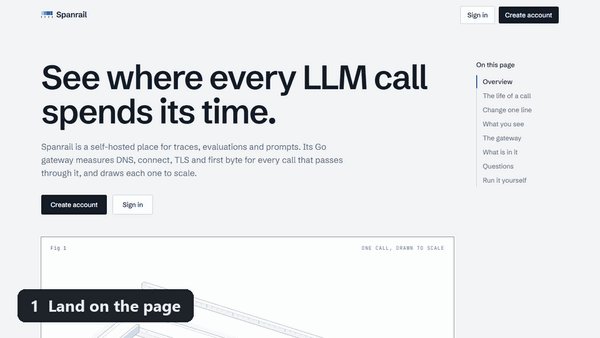

<div align="center">

# Spanrail

**See where every LLM call spends its time.**

Self-hosted traces, evals and prompts, plus a gateway that times every call: DNS, connect, TLS, the wait for the first byte, and the transfer.

[](https://pypi.org/project/spanrail/)
[](https://pypi.org/project/spanrail/)
[](https://github.com/Veeky-kumar/SpanRail/actions/workflows/web.yml)
[](./LICENSE)

[Website](https://spanrail.onrender.com) · [Architecture](./ARCHITECTURE.md) · [Python SDK](https://pypi.org/project/spanrail/)

[Install](#install-in-one-command) · [First trace](#send-your-first-trace) · [Gateway](#the-gateway-no-sdk-needed) · [Run it in public](#run-it-in-public) · [Backups](#backups) · [Limits](#known-limitations)

`curl -fsSL https://raw.githubusercontent.com/Veeky-kumar/SpanRail/main/deploy/install.sh | sh`

</div>



From the landing page to a first trace. The dashboards in the clip show demo data.

## Where did the time go?

Your LLM call took 3 seconds. Was it the DNS lookup? The TLS handshake? The provider thinking? The answer crawling back?

Most tools give you one number. Spanrail's gateway splits each call into its phases and draws them to scale, next to the traces, costs and prompts you already need. Point your client at the gateway, change nothing else, and every call shows up with its own time budget.

It runs on your machine. Spanrail itself never phones home.

## What you get

- **A time budget for every call.** DNS, connect, TLS, upstream wait and transfer on one ruler. Scrub through the average call, see the slow tail (p50 and p95), and see which model eats the bill.
- **Traces that nest.** Spans and generations with errors, token usage and cost.
- **An overview that answers questions.** Traces, error rate, latency and spend against the period before, plus a heatmap of when your calls arrive.
- **Models side by side.** Turn models on and off and see what each one costs and how it behaves.
- **Prompts with versions and labels.** Fetch `production` from your app, edit in the dashboard.
- **Evals you can rerun.** Datasets, runs and deterministic scorers, with a comparison between runs to catch regressions.
- **Projects and logins.** Each project has its own traces, prompts, datasets and API keys.
- **Plain infrastructure.** Postgres, Redis, a Next.js app, a worker and an optional Go gateway.

## Status

A working MVP, not a hardened product. It has basic rate limits and a switch to close signups, but it does not have password reset, roles with different powers, or an end-to-end test suite. The [known limitations](#known-limitations) list is the honest version.

## Install in one command

You need Docker with Compose v2. This pulls the published images, so there is nothing to clone or build:

```bash
curl -fsSL https://raw.githubusercontent.com/Veeky-kumar/SpanRail/main/deploy/install.sh | sh
```

It makes a `spanrail/` folder, writes a `.env` with fresh secrets, starts Postgres, Redis, the web app and the worker (migrations run first), and prints the address: `http://localhost:3000`. Create an account, make a project, make an API key, then [send a trace](#send-your-first-trace).

Prefer to read before you run? [`deploy/install.sh`](./deploy/install.sh) is short. The stack is [`deploy/docker-compose.yml`](./deploy/docker-compose.yml) plus a `.env`: copy [`deploy/.env.example`](./deploy/.env.example) and fill in the three secrets with `openssl rand -hex 32`. Add the gateway with `docker compose --profile gateway up -d` once your key pair is in `.env`.

Two things to know:

- The web app listens on `127.0.0.1` only. Put a reverse proxy with TLS in front before you open it up, and set `WEB_BIND=0.0.0.0` only behind one. Then read [Run it in public](#run-it-in-public).
- Pin a version with `SPANRAIL_VERSION=0.1.0` in `.env` (the default is `latest`). **Back up `.env`.** If you lose `API_KEY_SALT`, every API key stops working.

## Send your first trace

**Python** ([`spanrail` on PyPI](https://pypi.org/project/spanrail/), no dependencies, Python 3.9+):

```bash
pip install spanrail
```

```python
from spanrail import Spanrail

sr = Spanrail("pk-...", "sk-...", base_url="http://localhost:3000")

trace = sr.trace("support-chat", user_id="u_123")
with trace.generation("answer", model="gpt-4o-mini", input="Where is my order?") as gen:
    gen.end(output="It shipped yesterday.", usage={"input": 12, "output": 7})
```

Events are sent from a background thread and flushed when your program exits. The SDK never raises into your app. More in [sdk-python/README.md](./sdk-python/README.md).

**TypeScript** (not on npm yet, so import the local source):

```ts
import { Spanrail } from "./sdk"; // local source for now

const spanrail = new Spanrail({
  publicKey: process.env.SPANRAIL_PUBLIC_KEY!,
  secretKey: process.env.SPANRAIL_SECRET_KEY!,
  baseUrl: "http://localhost:3000",
});

const trace = spanrail.trace({ name: "my-agent-run", userId: "user_123" });
const span = trace.span({ name: "tool:search", input: { query: "..." } });
span.end({ output: { results: [] } });

const generation = trace.generation({ name: "llm:answer", model: "gpt-4o-mini" });
generation.end({ output: "...", usageDetails: { input: 120, output: 40 }, costDetails: { input: 0.00006, output: 0.00004 } });

await spanrail.shutdown(); // flushes queued events before the process exits
```

Fuller examples you can run:

- `examples/simple-agent.ts` is a multi-span agent with a deliberate tool failure, so you can see errors and nesting.
- `examples/run-dataset-eval.ts` runs the whole loop: dataset, run, scorers.

```bash
SPANRAIL_PUBLIC_KEY=pk-tw-... SPANRAIL_SECRET_KEY=sk-tw-... npx tsx examples/simple-agent.ts
```

## The gateway, no SDK needed

If you would rather not touch your code, use the gateway. [`gateway/`](./gateway) is a small reverse proxy in **Go** (standard library plus `prometheus/client_golang`) that sits in front of any OpenAI-compatible API. It forwards every request unchanged, streaming included, and reports each call to Spanrail with its DNS, connect, TLS and first-byte timings. It talks to Spanrail only through the public ingestion API, so the web app and worker do not depend on it.

```
your app --> spanrail-gateway (Go) --> LLM provider
                   |
                   +--(async, batched)--> Spanrail  POST /api/public/ingestion
```

A prebuilt image (linux/amd64 and linux/arm64, about 5 MB) is on GitHub Container Registry:

```bash
docker run -p 127.0.0.1:8080:8080 \
  -e UPSTREAM_URL=https://api.openai.com \
  -e SPANRAIL_BASE_URL=http://host.docker.internal:3000 \
  -e SPANRAIL_PUBLIC_KEY=pk-... -e SPANRAIL_SECRET_KEY=sk-... \
  ghcr.io/veeky-kumar/spanrail-gateway:latest
```

Then set your client's base URL to `http://localhost:8080/v1`. The provider key stays in your client.

Notes:

- `host.docker.internal` reaches a Spanrail running on your machine from Docker Desktop. On Linux, add `--add-host=host.docker.internal:host-gateway`, or use your server's address.
- The gateway does not authenticate its callers, so keep it on localhost or a private network.
- To build it yourself you need **Go 1.27.3+** (the Docker image does it for you). From the repo root, with the key pair that `npm run db:seed` printed:

  ```bash
  export SPANRAIL_PUBLIC_KEY=pk-... SPANRAIL_SECRET_KEY=sk-...
  docker compose --profile gateway up -d --build gateway   # listens on 127.0.0.1:8080
  ```

Configuration, the Go test and CI commands, and the measured results are in [gateway/README.md](./gateway/README.md) and [gateway/RESULTS.md](./gateway/RESULTS.md). The gateway has its own CI ([`gateway.yml`](./.github/workflows/gateway.yml)): gofmt, vet, race-detector tests, build, `govulncheck` and a Docker image build.

## Prompt management

Create a prompt and fetch it by label over HTTP:

```bash
curl -X POST http://localhost:3000/api/public/prompts \
  -H "authorization: Basic $(echo -n "$SPANRAIL_PUBLIC_KEY:$SPANRAIL_SECRET_KEY" | base64)" \
  -H "content-type: application/json" \
  -d '{"name":"support-agent","prompt":"You are a support agent. {{tone}}","labels":["production"]}'

curl "http://localhost:3000/api/public/prompts/support-agent?label=production" \
  -H "authorization: Basic $(echo -n "$SPANRAIL_PUBLIC_KEY:$SPANRAIL_SECRET_KEY" | base64)"
```

The dashboard's Prompts tab uses the same code path.

## Run it in public

If your instance is reachable from the internet:

- **Close signups** once your team has accounts: set `SIGNUPS_DISABLED=true`. Existing users still sign in, and the sign-up page says registration is closed.
- **Rate limits** cover sign-in, sign-up and ingestion (details in [ARCHITECTURE.md](./ARCHITECTURE.md)).
- **Search and link previews:** set `SITE_URL` to your public address (for example `https://spanrail.example.com`). The landing page then gets a canonical link, a link-preview card, a sitemap and structured data. Leave it unset on a private install: the site then asks search engines not to index it.
- **Health check:** `GET /api/health` answers `{"status":"ok"}`, or 503 when the database is unreachable. Point an uptime monitor at it.

### Backups

`.github/workflows/backup.yml` dumps the database every night, encrypts the dump and keeps it for 14 days as a workflow artifact. It does nothing until you add two repository secrets:

- `BACKUP_DATABASE_URL`: the database's external connection string.
- `BACKUP_PASSPHRASE`: a long random passphrase. Keep a copy somewhere safe, because without it the backups cannot be read.

The dump is encrypted because artifacts of a public repository can be downloaded by any signed-in GitHub user.

To restore, download the artifact, then:

```bash
openssl enc -d -aes-256-cbc -pbkdf2 -iter 600000 -in spanrail-YYYY-MM-DD.dump.enc -out spanrail.dump
pg_restore --no-owner --no-privileges --clean --if-exists -d "$DATABASE_URL" spanrail.dump
```

Try a restore into an empty database once, before you need it. Dumps are made with Postgres 18 tools, so restore them with a `pg_restore` of version 18 or newer; an older one refuses the file. Restoring into an older server can print warnings about settings it does not know, so read them before you trust the result.

## Who is visiting? (optional)

A self-hosted install never reports anything to anyone. If you run a public instance with a landing page, two optional features show you who arrives:

- **Umami** ([umami.is](https://umami.is), privacy-friendly, no cookies). Set `UMAMI_SCRIPT_URL` (for example `https://cloud.umami.is/script.js`) and `UMAMI_WEBSITE_ID`. The tracker loads only on the landing, sign-in and sign-up pages, never inside the signed-in app, and it respects Do Not Track. If either variable is unset, nothing loads.
- **Signups and funnel** at `/admin/growth`, for the addresses in `ADMIN_EMAILS` (comma separated; everyone else gets a 404). It counts accounts per day, how far people get (project, API key, trace, gateway call) and where they came from. At sign-up the app records the referring site, any `utm_source`, `utm_medium` and `utm_campaign` tags, and a two-letter country when your host's edge network sends one (for example `CF-IPCountry`). It never stores a path, a query string or an IP address, and the sign-up form says so. A first-party cookie (`sr_src`, 30 days) carries the source from the first page to sign-up, and it is skipped when the browser sends Do Not Track.

## Develop on it

You need Node 24+, Docker, and a Postgres and Redis pair (the included Compose file gives you both).

```bash
npm install
cp .env.example .env            # edit if you changed the Compose ports below
docker compose up -d            # starts Postgres (5455) and Redis (6399)
npm run db:migrate              # applies the schema
npm run db:seed                 # creates a demo user, project and API key. Read the output.
```

The seed prints a demo login (`demo@spanrail.local` and a password) and an SDK key pair (`SPANRAIL_PUBLIC_KEY`, `SPANRAIL_SECRET_KEY`). Save the secret key now: it is hashed at rest and cannot be recovered.

Then, in two terminals:

```bash
npm run dev      # dashboard and public API at http://localhost:3000
npm run worker   # background ingestion. Traces will not appear unless this is running.
```

Sign in at `http://localhost:3000/login` with the seeded account.

**Tests**

```bash
npm run typecheck   # strict TypeScript across the project
npm test            # unit tests: trace trees, scorers, hashing, formatting, charts
```

The unit tests cover logic that needs no database. The path from ingestion to worker to dashboard, auth and the eval pipeline are exercised by the `examples/*.ts` scripts and by hand. There is no automated end-to-end suite for the Node app yet.

**Containers for a real deployment**

```bash
cp .env.production.example .env.production   # set real secrets; the file explains each one
docker compose -f docker-compose.yml -f docker-compose.prod.yml --env-file .env.production up -d --build
docker compose -f docker-compose.yml -f docker-compose.prod.yml exec web npx prisma migrate deploy
```

This builds `web` and `worker` as containers next to Postgres and Redis. See [docker-compose.prod.yml](./docker-compose.prod.yml) and the Dockerfiles in [docker/](./docker) for exactly what ships.

## Known limitations

The full list is in [ARCHITECTURE.md](./ARCHITECTURE.md#known-mvp-gaps). In short:

- **Basic rate limits only.** Sign-in, sign-up and ingestion are limited per address and per project, in memory in each web process. The rest of the dashboard has none, and there is no password reset or email flow.
- **No LLM-as-judge evals yet.** The deterministic scorers (`exact_match`, `contains`, `json_valid`) are built and tested. Model-based judging has a reserved name (`llm_judge:*`) but is not connected to any provider.
- **Flat roles.** `OWNER` and `MEMBER` exist in the schema, but both have the same permissions today.
- **Postgres only.** There is no ClickHouse or blob-storage tier. That is fine at MVP volumes, and the first thing to add if ingestion or analytics queries slow down (see "Scaling path" in ARCHITECTURE.md).
- **No automated end-to-end suite for the Node app.** Coverage is unit-level. The Go gateway is the exception: it has a scripted end-to-end run (`gateway/scripts/e2e.sh`, run by hand), and its unit tests, vet and vulnerability check run in CI.
- **SDKs.** Python is on PyPI, and TypeScript is local source only. Neither has helper methods for datasets, so call those endpoints over HTTP. The Go gateway needs no SDK, but it only understands OpenAI-compatible HTTP traffic.

## License

MIT. See [LICENSE](LICENSE) and [THIRD_PARTY_NOTICES.md](THIRD_PARTY_NOTICES.md).
